# Architecture diagrams

Five diagrams (the ERD is drawn as an overview plus one page per database), each kept as a typed archify IR file (`*.json`), a rendered interactive page (`*.html`), and a Mermaid copy below that renders inline on any git host. The prose is in [overview.md](overview.md); decisions are in [`docs/adrs/`](../adrs/).

| Diagram                                      | Interactive page                           | Typed source                               |
| -------------------------------------------- | ------------------------------------------ | ------------------------------------------ |
| Context and containers                       | [architecture.html](architecture.html)     | [architecture.json](architecture.json)     |
| Sequence: the 8-step workflow                | [sequence.html](sequence.html)             | [sequence.json](sequence.json)             |
| Workflow: redemption saga with compensations | [workflow.html](workflow.html)             | [workflow.json](workflow.json)             |
| ERD: overview of the three databases         | [erd.html](erd.html)                       | [erd.json](erd.json)                       |
| ERD: identity (13 tables)                    | [erd-identity.html](erd-identity.html)     | [erd-identity.json](erd-identity.json)     |
| ERD: engagement (15 tables)                  | [erd-engagement.html](erd-engagement.html) | [erd-engagement.json](erd-engagement.json) |
| ERD: payments (22 tables)                    | [erd-payments.html](erd-payments.html)     | [erd-payments.json](erd-payments.json)     |
| Lifecycle: redemption states                 | [lifecycle.html](lifecycle.html)           | [lifecycle.json](lifecycle.json)           |

The HTML pages are standalone files; open them locally in a browser (a git host shows their source, not the page).

## Why each diagram exists

Each diagram answers one question. The table links the question to the Part A items of the task, the decisions
behind it and the reliability cases it shows. To go from a document to a picture, follow the "Diagram:" line at
the top of every ADR, of the overview and of the specs. Each picture below is a PNG render; the interactive
page is the `*.html` file next to it (see [View it locally](#view-it-locally)).

| Diagram                                                                     | Question it answers                                                                                                     | Part A items                                                                                                            | ADRs                                                                                                                                                                                                                                                                                                                                                                       | Specs                                                                                                                                                                    | Part C                                                        |
| --------------------------------------------------------------------------- | ----------------------------------------------------------------------------------------------------------------------- | ----------------------------------------------------------------------------------------------------------------------- | -------------------------------------------------------------------------------------------------------------------------------------------------------------------------------------------------------------------------------------------------------------------------------------------------------------------------------------------------------------------------- | ------------------------------------------------------------------------------------------------------------------------------------------------------------------------ | ------------------------------------------------------------- |
| [Context and containers](#1-context-and-containers)                         | What are the parts and who talks to whom?                                                                               | tenant isolation, integration layer, identity mapping, ledger, admin configuration (web console), observability (Varta) | [0001](../adrs/0001-microservices-and-their-cost.md), [0002](../adrs/0002-tenancy-model.md), [0003](../adrs/0003-rabbitmq-outbox-inbox.md), [0007](../adrs/0007-identity-interface-and-emulator.md), [0008](../adrs/0008-integration-adapters-canonical-model.md), [0009](../adrs/0009-analytics-via-varta.md), [0011](../adrs/0011-container-per-service-and-deckhand.md) | all five                                                                                                                                                                 | C-7 tenant isolation                                          |
| [Sequence: the 8-step workflow](#2-sequence-the-8-step-workflow)            | What happens, in order, from deposit to a tracked reward?                                                               | ingestion, validation and deduplication, identity mapping, ledger, redemption and delivery                              | [0003](../adrs/0003-rabbitmq-outbox-inbox.md), [0004](../adrs/0004-virtual-currency-ledger.md), [0005](../adrs/0005-rng-and-fairness.md), [0006](../adrs/0006-redemption-saga.md), [0008](../adrs/0008-integration-adapters-canonical-model.md)                                                                                                                            | [engagement-ingest](../specs/engagement-ingest.md), [identity](../specs/identity.md), [payments](../specs/payments.md), [engagement-store](../specs/engagement-store.md) | C-1 duplicate deposit, C-2 concurrent spins                   |
| [Workflow: redemption saga](#3-workflow-redemption-saga-with-compensations) | Which steps and compensations does a redemption run, and who owns each?                                                 | redemption and delivery                                                                                                 | [0006](../adrs/0006-redemption-saga.md), [0004](../adrs/0004-virtual-currency-ledger.md), [0008](../adrs/0008-integration-adapters-canonical-model.md)                                                                                                                                                                                                                     | [engagement-store](../specs/engagement-store.md), [payments](../specs/payments.md)                                                                                       | C-3 duplicate redemption, C-4 timeout, failed reward issuance |
| [ERD: the three databases](#4-erd-the-schema-of-the-three-databases)        | Which tables exist (50, in 3 databases), which carry the tenant (RLS) and `sandbox`, and how do ledger entries balance? | tenant isolation, ledger, identity mapping                                                                              | [0002](../adrs/0002-tenancy-model.md), [0004](../adrs/0004-virtual-currency-ledger.md), [0007](../adrs/0007-identity-interface-and-emulator.md)                                                                                                                                                                                                                            | [identity](../specs/identity.md), [payments](../specs/payments.md)                                                                                                       | C-6b no negative balance, C-7 tenant isolation                |
| [Lifecycle: redemption states](#5-lifecycle-redemption-states)              | Which states can a redemption be in, and which moves are allowed?                                                       | redemption and delivery                                                                                                 | [0006](../adrs/0006-redemption-saga.md)                                                                                                                                                                                                                                                                                                                                    | [engagement-store](../specs/engagement-store.md)                                                                                                                         | C-4 timeout and recovery, failed reward issuance              |

How to read them: solid arrows are synchronous calls, dotted arrows are events through the broker or
best-effort emissions. Boxes inside the platform frame are containers, one per service. In the saga and the
lifecycle the main path runs left to right and ends in `COMPLETED`; every other branch is a compensation or a
recovery path.

Part A items without a diagram of their own: the rules engine, admin configuration, and observability and security.
The context diagram shows them only as components (engagement, the web console, Varta). They are described in
[overview.md](overview.md), sections 12 and following, and in the specs, and no diagram is drawn for them.

## View it locally

The interactive pages are standalone HTML files with no server needed. Open one in a browser:

```sh
xdg-open docs/architecture/architecture.html   # Linux
open docs/architecture/architecture.html       # macOS
```

GitHub shows the source of an HTML file, not the page, so use the Mermaid blocks below or the PNG renders in
[`img/`](img/) when you read on GitHub. The PNG files are `architecture.png`, `sequence.png`, `workflow.png`,
`erd.png`, `erd-identity.png`, `erd-engagement.png`, `erd-payments.png` and `lifecycle.png`.

## Tooling and version

- Archify is a git submodule at `tools/archify`, pinned to tag `v3.2.0` (commit `208acba8d412335185b2056fedf54b3405df43fb`), Apache-2.0.
- `tools/archify-render.sh` validates and re-renders all eight IR files (the five diagrams, with the ERD as an overview and three per-database pages). `tools/archify-render.sh --check` validates only, for CI. Needs Node 18 or newer and `git submodule update --init tools/archify`.
- The Mermaid copies are written by hand and must agree with the IR files. When one changes, change the other (ADR 0012).
- Built, partial and next items are marked in [overview.md](overview.md#14-built-versus-designed). The Stripe adapter, websocket replay, the production identity provider, rate limiting and per-service deployment secrets are next, not built.
- The Mermaid copies and the IR files agree with the code. The `*.html` pages were re-rendered from the corrected IR with the pinned archify renderer. The ERDs were checked table by table against the migrations and against a live stack (`\dt`, `\d` in each database); the other diagrams were checked against `docker-compose.yml`, `packages/contracts` (events), the controllers (routes), `redemption-state.ts`, the saga service, the realtime gateway and `docs/observability/varta.md`.

## 1. Context and containers

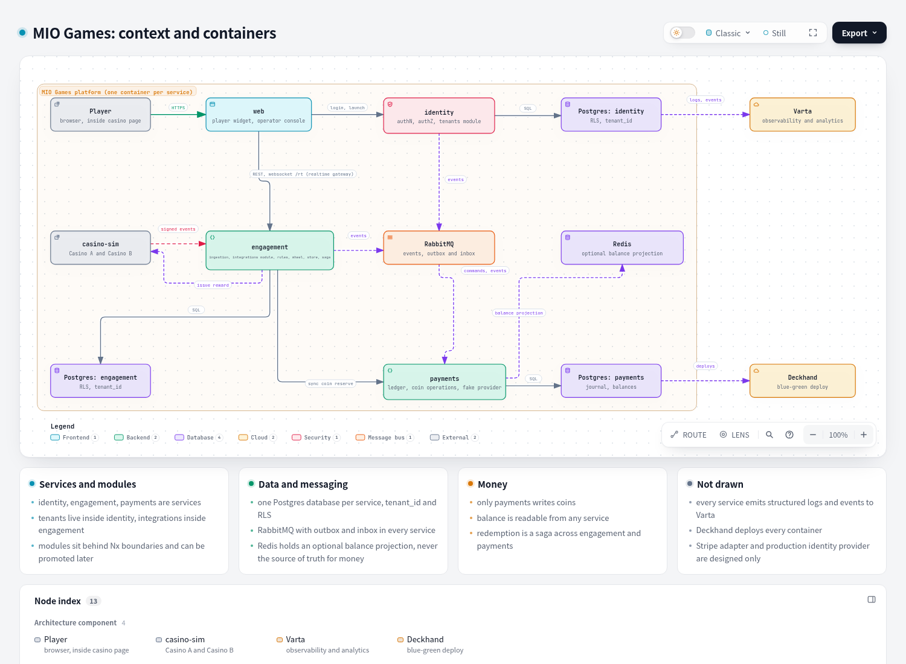

Interactive page: [`architecture.html`](architecture.html), opened locally. Mermaid copy:

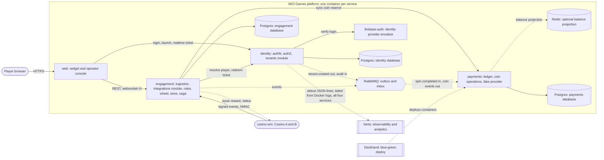

## 2. Sequence: the 8-step workflow

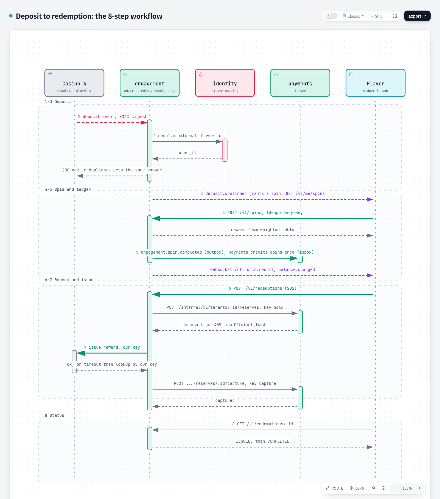

Interactive page: [`sequence.html`](sequence.html), opened locally. Mermaid copy:

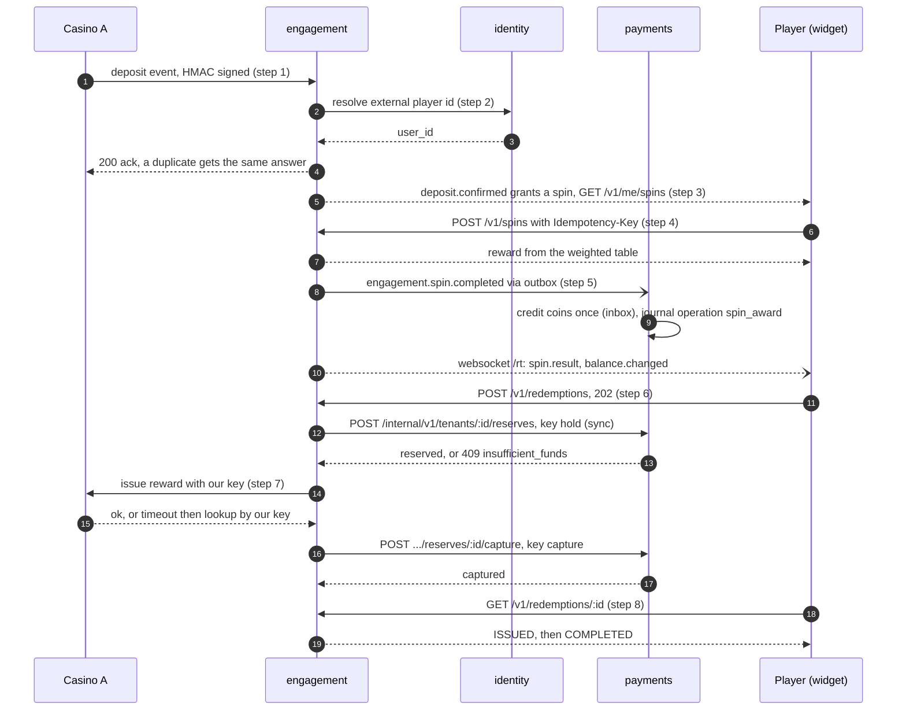

## 3. Workflow: redemption saga with compensations


Interactive page: [`workflow.html`](workflow.html), opened locally. Mermaid copy:

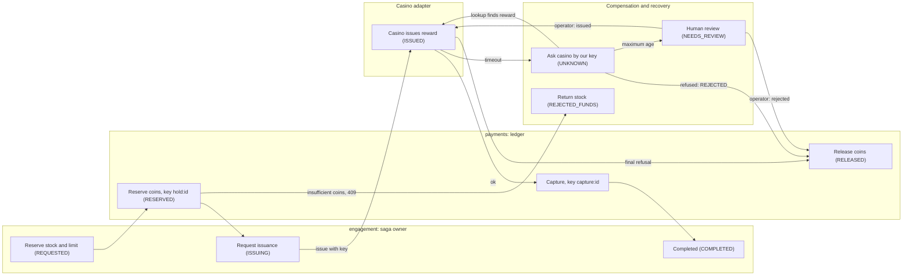

## 4. ERD: the schema of the three databases

<a id="4-erd-tenancy-and-ledger"></a>


Overview page: [`erd.html`](erd.html) (source [`erd.json`](erd.json)). It shows the tables that link the three
databases and the logical (dashed) links between them. The full schema is drawn once per database, from the TypeORM
migrations in `apps/*/src/model/migrations` (the final state after all of them) and checked against the live
databases with `\dt` and `\d` on a running stack:

| Database   | Tables | Business | Shared (outbox, inbox, audit_intents) | Interactive page                           | Typed source                               | PNG                                          |
| ---------- | ------ | -------- | ------------------------------------- | ------------------------------------------ | ------------------------------------------ | -------------------------------------------- |
| identity   | 13     | 10       | 3                                     | [erd-identity.html](erd-identity.html)     | [erd-identity.json](erd-identity.json)     | [erd-identity.png](img/erd-identity.png)     |
| engagement | 15     | 12       | 3                                     | [erd-engagement.html](erd-engagement.html) | [erd-engagement.json](erd-engagement.json) | [erd-engagement.png](img/erd-engagement.png) |
| payments   | 22     | 19       | 3                                     | [erd-payments.html](erd-payments.html)     | [erd-payments.json](erd-payments.json)     | [erd-payments.png](img/erd-payments.png)     |

That is 50 tables, 41 of them business tables (the TypeORM `migrations` bookkeeping table is not counted).
`outbox` and `inbox` (the bus tables) and `audit_intents` are created in every database by `packages/bus` and
`packages/service-kit`. Every table has `tenant_id` except `tenants` (its `id` is the tenant), `signing_keys` and `billing_plans` (both global).

Tenant scope and RLS (the policy is `tenant_id = current_setting('app.tenant_id')`, with `WITH CHECK`):

- ENABLE + FORCE RLS: every table with `tenant_id` except the ones below. That is 9 of the 13 identity tables
  (`users`, `user_roles`, `provider_links`, `player_links`, `launch_jti`, `integration_credentials`, `audit_log`,
  `reward_apis`, `audit_intents`), all 12 business tables of engagement and its `audit_intents`, and 18 of the 22
  payments tables.
- ENABLE without FORCE: `tenants` (identity), scoped on its own `id`.
- No RLS: `outbox` and `inbox` in all three databases (the relay and the dedupe work across tenants),
  `signing_keys` (identity), `billing_plans` and `reconciliation_tenants` (payments).

Tables that carry `sandbox` (the environment is part of the key, so production and sandbox never meet): `launch_jti`
(identity); `inbound_events`, `spin_credits`, `item_player_usage` and `redemptions` (engagement); `wallets`,
`accounts` and `wallet_owner_links` (payments). `integration_credentials` and `reward_apis` name the environment in an
`environment` text column (`production` or `sandbox`) instead.

Cross-service relations are logical, never foreign keys, and are drawn dashed or annotated: `tenant_id` in every
database points at identity `tenants`; `wallet_owner_links.user_id` (payments), `spin_credits.user_id` and
`redemptions.player_id` (engagement) hold an identity `users.id`; engagement `tenant_projections` is an event-fed copy
of `tenants`. Declared foreign keys exist only inside a database (identity: 7 tables to `tenants` and `users`;
engagement: `spins` to `spin_credits`; payments: the ledger and billing tables). Links such as `redemptions.item_id`
are logical inside engagement too and are drawn dashed.

### Identity (13 tables)

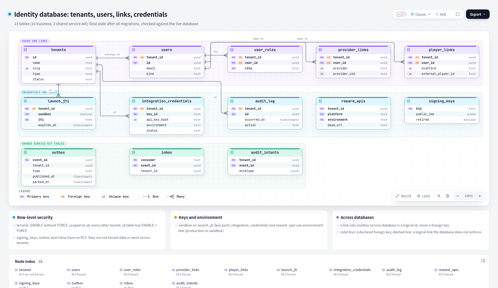

Interactive page: [`erd-identity.html`](erd-identity.html), opened locally. Mermaid copy:

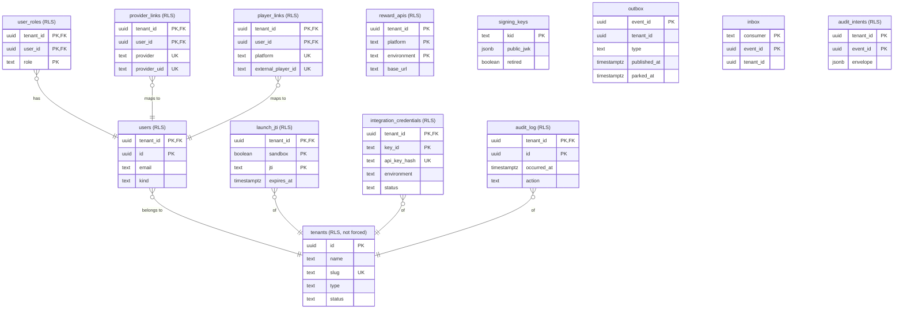

### Engagement (15 tables)

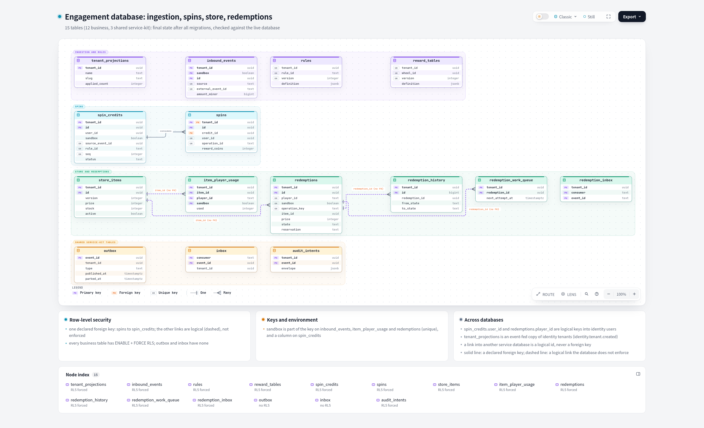

Interactive page: [`erd-engagement.html`](erd-engagement.html), opened locally. Mermaid copy:

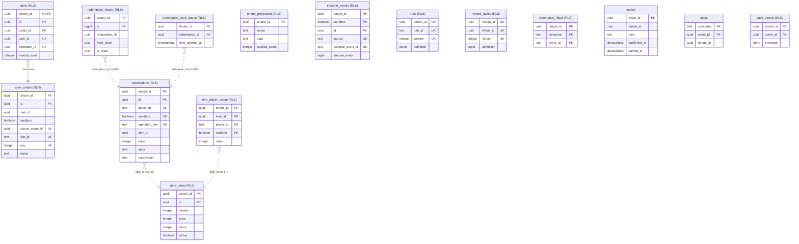

### Payments (22 tables)

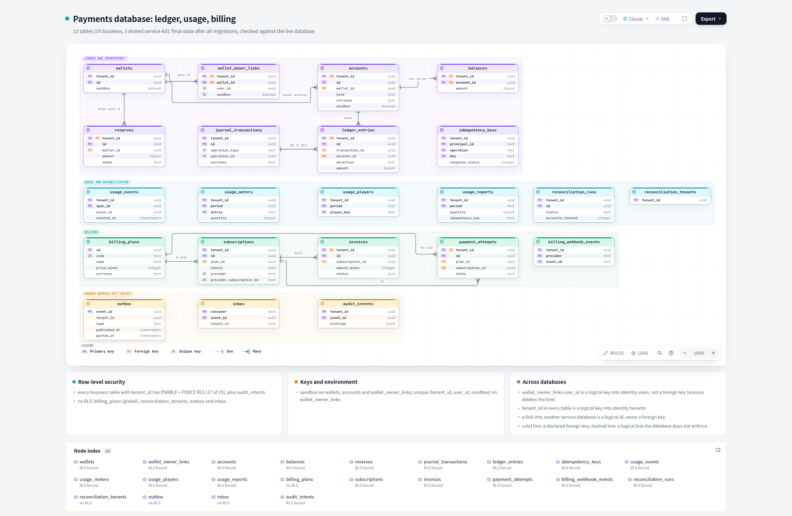

Interactive page: [`erd-payments.html`](erd-payments.html), opened locally. Mermaid copy:

```mermaid
erDiagram
  wallet_owner_links }o--|| wallets : "owner of"
  accounts }o--|| wallets : "player accounts"
  balances }o--|| accounts : "one row per"
  reserves }o--|| wallets : "holds coins of"
  ledger_entries }o--|| journal_transactions : "two or more"
  ledger_entries }o--|| accounts : "moves"
  subscriptions }o--|| billing_plans : "on plan"
  invoices }o--|| subscriptions : "bills"
  payment_attempts }o--|| subscriptions : "for"
  payment_attempts }o--|| billing_plans : "for plan"

  wallets["wallets (RLS)"] {
    uuid tenant_id PK
    uuid id PK
    boolean sandbox
  }
  wallet_owner_links["wallet_owner_links (RLS)"] {
    uuid tenant_id PK, FK
    uuid wallet_id PK, FK
    uuid user_id UK
    boolean sandbox UK
  }
  accounts["accounts (RLS)"] {
    uuid tenant_id PK, FK
    uuid id PK
    uuid wallet_id FK
    text kind
    text currency
    boolean sandbox
  }
  balances["balances (RLS)"] {
    uuid tenant_id PK, FK
    uuid account_id PK, FK
    bigint amount
  }
  reserves["reserves (RLS)"] {
    uuid tenant_id PK, FK
    uuid id PK
    uuid wallet_id FK
    bigint amount
    text state
  }
  journal_transactions["journal_transactions (RLS)"] {
    uuid tenant_id PK
    uuid id PK
    text operation_type UK
    uuid operation_id UK
    text currency
  }
  ledger_entries["ledger_entries (RLS)"] {
    uuid tenant_id PK, FK
    uuid id PK
    uuid transaction_id FK
    uuid account_id FK
    text direction
    bigint amount
  }
  idempotency_keys["idempotency_keys (RLS)"] {
    uuid tenant_id PK
    text principal_id PK
    text operation PK
    text key PK
    integer response_status
  }
  usage_events["usage_events (RLS)"] {
    uuid tenant_id PK
    uuid spin_id PK
    uuid event_id
    timestamptz counted_at
  }
  usage_meters["usage_meters (RLS)"] {
    uuid tenant_id PK
    text period PK
    text metric PK
    bigint quantity
  }
  usage_players["usage_players (RLS)"] {
    uuid tenant_id PK
    text period PK
    text player_key PK
  }
  usage_reports["usage_reports (RLS)"] {
    uuid tenant_id PK
    text period PK
    bigint quantity
    text idempotency_key
  }
  billing_plans {
    uuid id PK
    text code UK
    text name
    integer price_minor
    text currency
  }
  subscriptions["subscriptions (RLS)"] {
    uuid tenant_id PK
    uuid id PK
    uuid plan_id FK
    text status
    text provider UK
    text provider_subscription_id UK
  }
  invoices["invoices (RLS)"] {
    uuid tenant_id PK, FK
    uuid id PK
    uuid subscription_id FK
    integer amount_minor
    text status
  }
  payment_attempts["payment_attempts (RLS)"] {
    uuid tenant_id PK, FK
    uuid id PK
    uuid plan_id FK
    uuid subscription_id FK
    text state
  }
  billing_webhook_events["billing_webhook_events (RLS)"] {
    uuid tenant_id PK
    text provider PK
    text event_id PK
  }
  reconciliation_runs["reconciliation_runs (RLS)"] {
    uuid tenant_id PK
    uuid id PK
    text status
    integer accounts_checked
  }
  reconciliation_tenants {
    uuid tenant_id PK
  }
  outbox {
    uuid event_id PK
    uuid tenant_id
    text type
    timestamptz published_at
    timestamptz parked_at
  }
  inbox {
    text consumer PK
    uuid event_id PK
    uuid tenant_id
  }
  audit_intents["audit_intents (RLS)"] {
    uuid tenant_id PK
    uuid event_id PK
    jsonb envelope
  }
```

Balances sit in `balances` (one row per account, `amount >= 0`); the ledger is `journal_transactions` with its
`ledger_entries` (a deferred trigger checks that debits equal credits, and a repeat is stopped by the unique
`(tenant_id, operation_type, operation_id)`). Operation types are `spin_award`, `reserve`, `capture`, `release` and
`refund`.

## 5. Lifecycle: redemption states

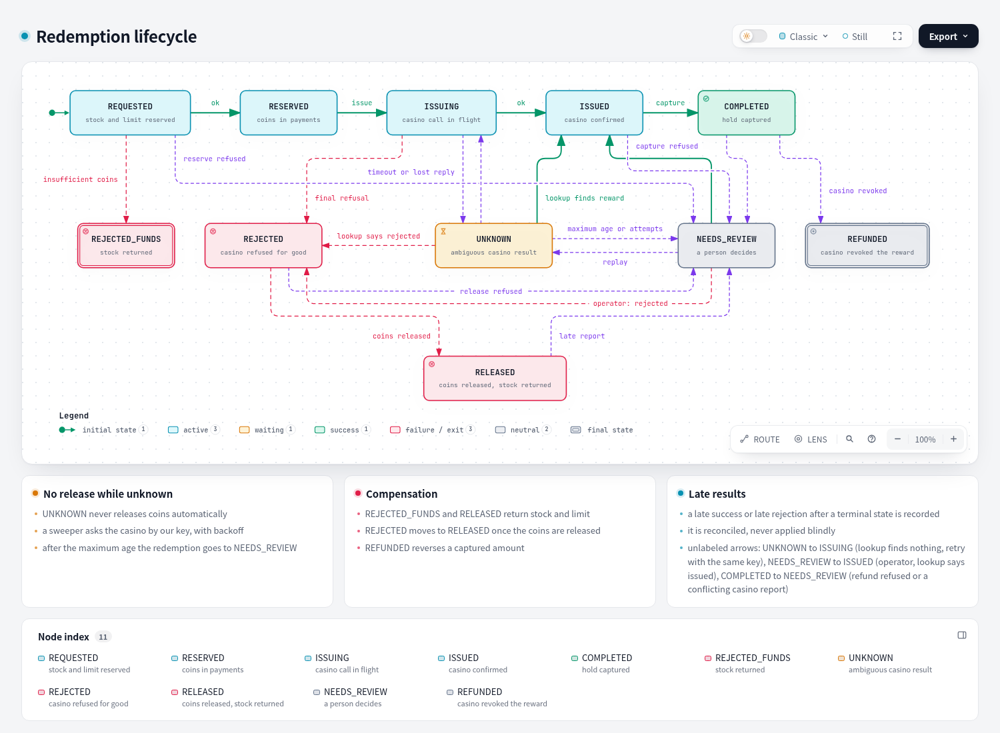

Interactive page: [`lifecycle.html`](lifecycle.html), opened locally. Mermaid copy:

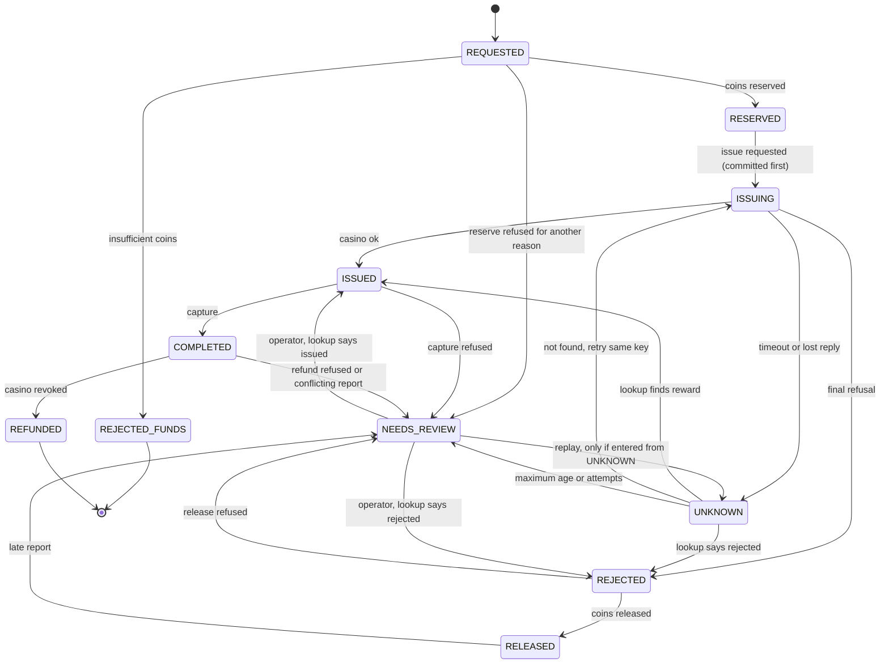
