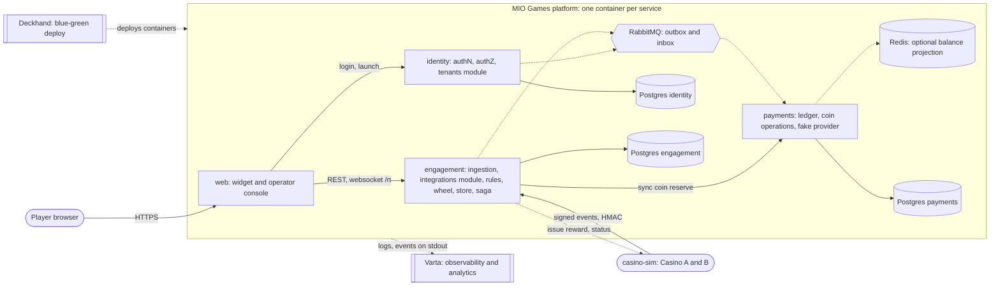
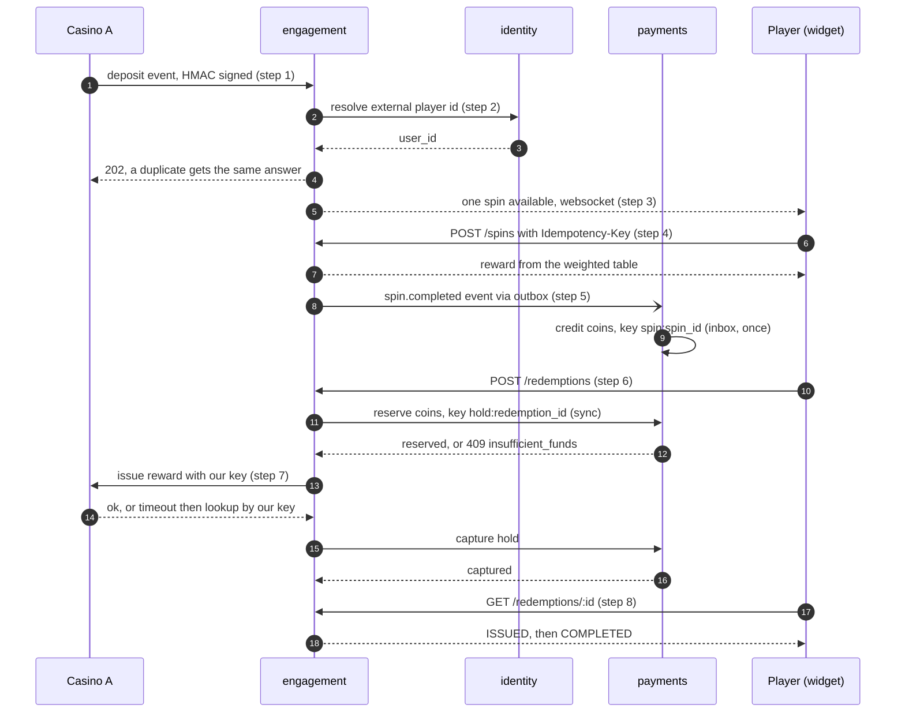
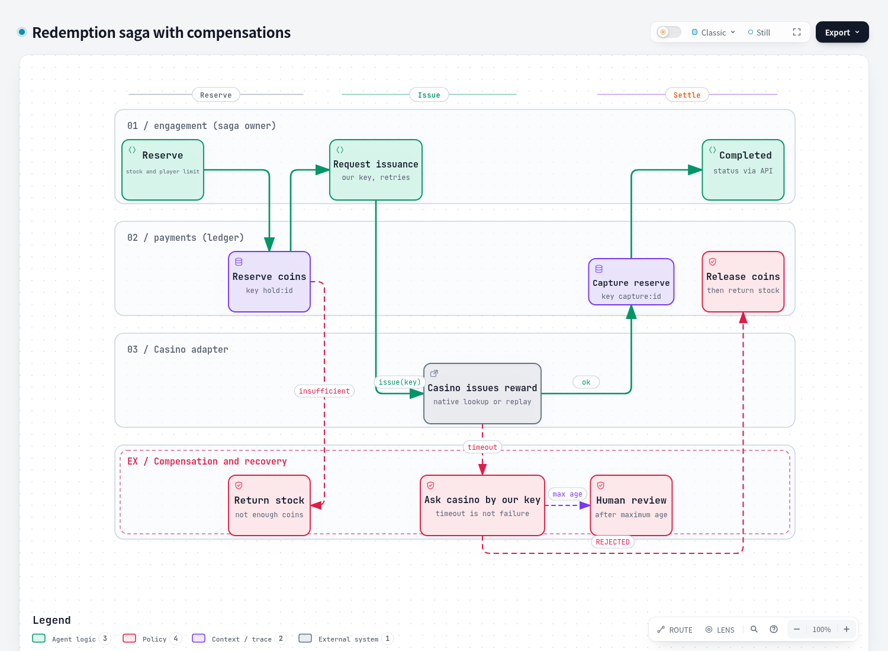
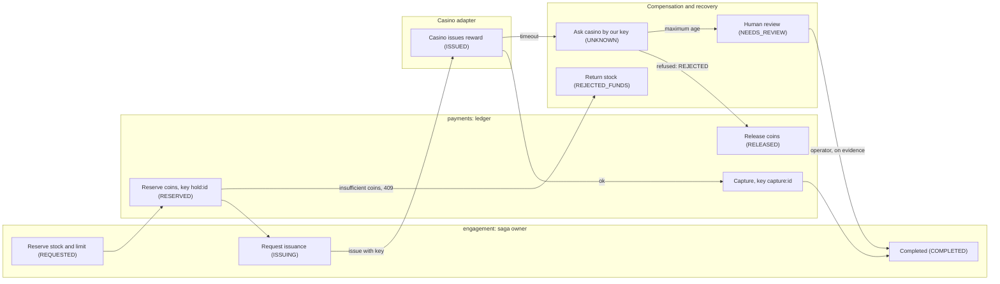
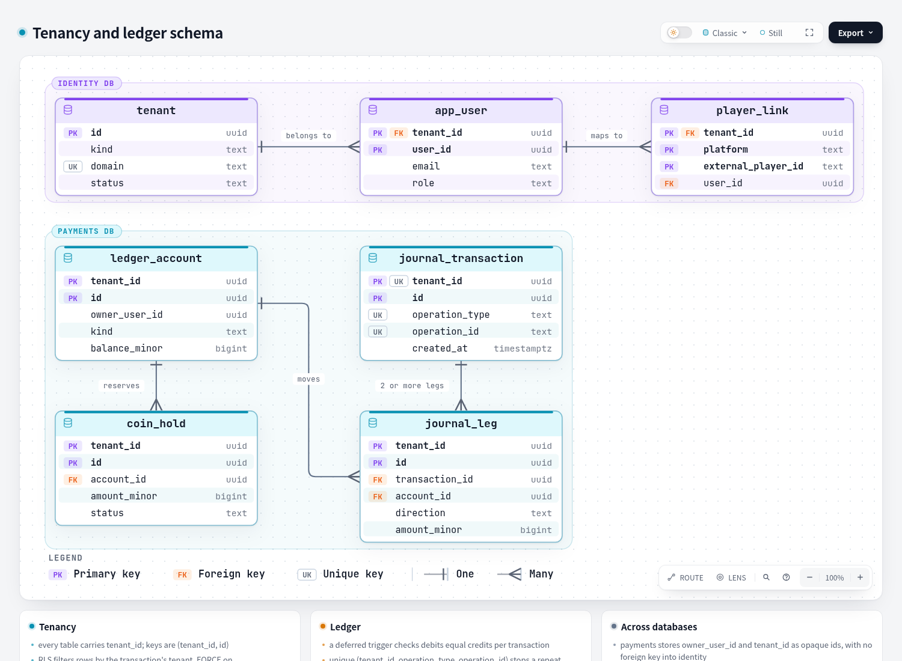
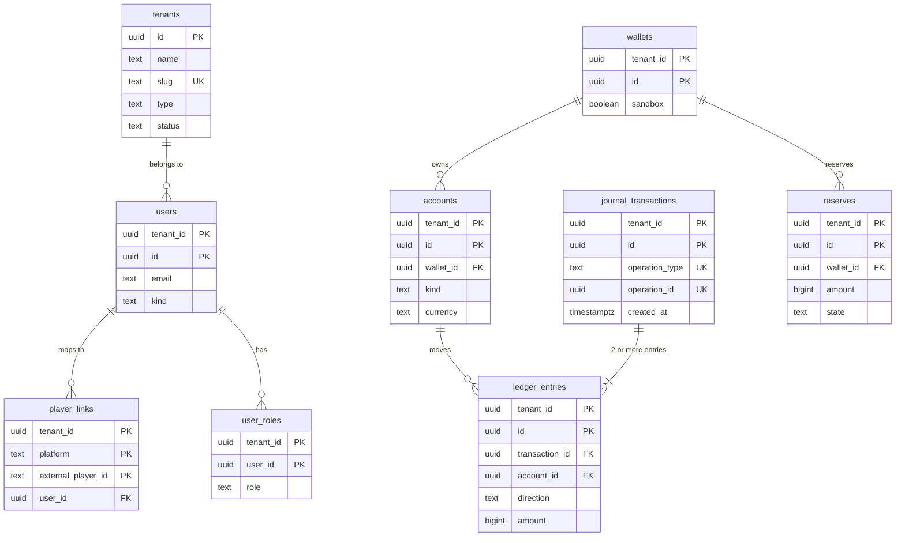
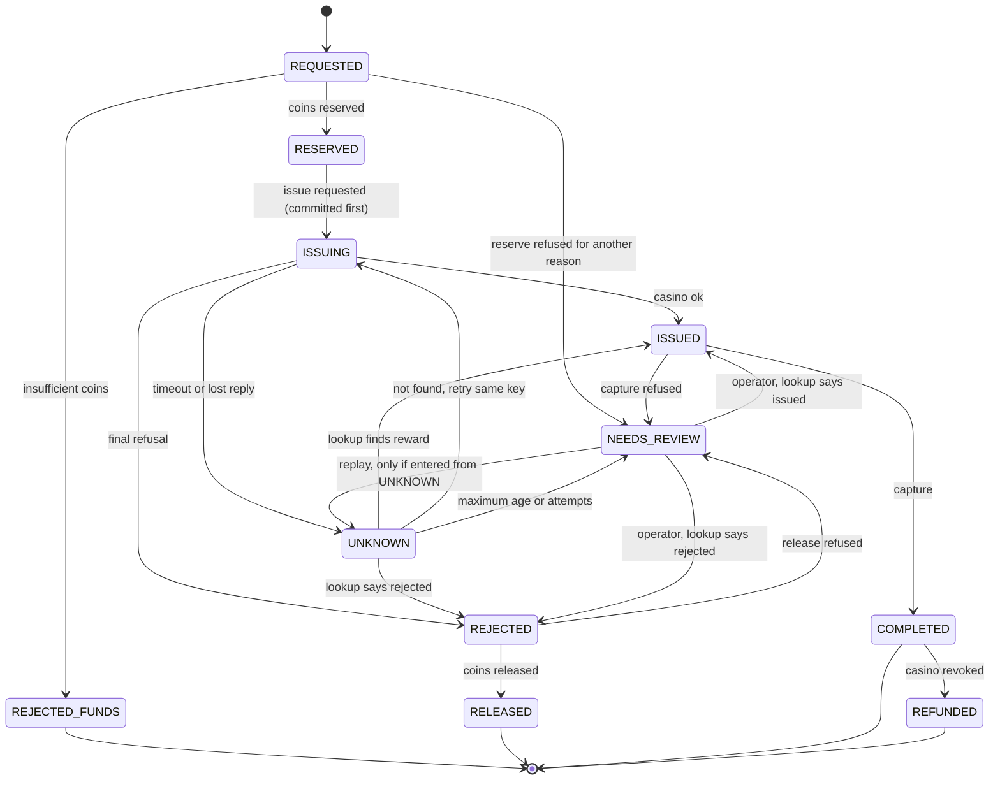

# Architecture diagrams

Five diagrams, each kept as a typed archify IR file (`*.json`), a rendered interactive page (`*.html`), and a Mermaid copy below that renders inline on any git host. The prose is in [overview.md](overview.md); decisions are in [`docs/adrs/`](../adrs/).

| Diagram                                      | Interactive page                       | Typed source                           |
| -------------------------------------------- | -------------------------------------- | -------------------------------------- |
| Context and containers                       | [architecture.html](architecture.html) | [architecture.json](architecture.json) |
| Sequence: the 8-step workflow                | [sequence.html](sequence.html)         | [sequence.json](sequence.json)         |
| Workflow: redemption saga with compensations | [workflow.html](workflow.html)         | [workflow.json](workflow.json)         |
| ERD: tenancy and ledger                      | [erd.html](erd.html)                   | [erd.json](erd.json)                   |
| Lifecycle: redemption states                 | [lifecycle.html](lifecycle.html)       | [lifecycle.json](lifecycle.json)       |

The HTML pages are standalone files; open them locally in a browser (a git host shows their source, not the page).

## Why each diagram exists

Each diagram answers one question. The table links the question to the Part A items of the task, the decisions
behind it and the reliability cases it shows. To go from a document to a picture, follow the "Diagram:" line at
the top of every ADR, of the overview and of the specs. Each picture below is a PNG render; the interactive
page is the `*.html` file next to it (see [View it locally](#view-it-locally)).

| Diagram                                                                     | Question it answers                                                     | Part A items                                                                                                            | ADRs                                                                                                                                                                                                                                                                                                                                                                       | Specs                                                                                                                                                                    | Part C                                                     |
| --------------------------------------------------------------------------- | ----------------------------------------------------------------------- | ----------------------------------------------------------------------------------------------------------------------- | -------------------------------------------------------------------------------------------------------------------------------------------------------------------------------------------------------------------------------------------------------------------------------------------------------------------------------------------------------------------------- | ------------------------------------------------------------------------------------------------------------------------------------------------------------------------ | ---------------------------------------------------------- |
| [Context and containers](#1-context-and-containers)                         | What are the parts and who talks to whom?                               | tenant isolation, integration layer, identity mapping, ledger, admin configuration (web console), observability (Varta) | [0001](../adrs/0001-microservices-and-their-cost.md), [0002](../adrs/0002-tenancy-model.md), [0003](../adrs/0003-rabbitmq-outbox-inbox.md), [0007](../adrs/0007-identity-interface-and-emulator.md), [0008](../adrs/0008-integration-adapters-canonical-model.md), [0009](../adrs/0009-analytics-via-varta.md), [0011](../adrs/0011-container-per-service-and-deckhand.md) | all five                                                                                                                                                                 | C-7 tenant isolation                                       |
| [Sequence: the 8-step workflow](#2-sequence-the-8-step-workflow)            | What happens, in order, from deposit to a tracked reward?               | ingestion, validation and deduplication, identity mapping, ledger, redemption and delivery                              | [0003](../adrs/0003-rabbitmq-outbox-inbox.md), [0004](../adrs/0004-virtual-currency-ledger.md), [0005](../adrs/0005-rng-and-fairness.md), [0006](../adrs/0006-redemption-saga.md), [0008](../adrs/0008-integration-adapters-canonical-model.md)                                                                                                                            | [engagement-ingest](../specs/engagement-ingest.md), [identity](../specs/identity.md), [payments](../specs/payments.md), [engagement-store](../specs/engagement-store.md) | C-1 duplicate deposit, C-2 concurrent spins                |
| [Workflow: redemption saga](#3-workflow-redemption-saga-with-compensations) | Which steps and compensations does a redemption run, and who owns each? | redemption and delivery                                                                                                 | [0006](../adrs/0006-redemption-saga.md), [0004](../adrs/0004-virtual-currency-ledger.md), [0008](../adrs/0008-integration-adapters-canonical-model.md)                                                                                                                                                                                                                     | [engagement-store](../specs/engagement-store.md), [payments](../specs/payments.md)                                                                                       | C-3 duplicate redemption, C-4 timeout, C-8 failed issuance |
| [ERD: tenancy and ledger](#4-erd-tenancy-and-ledger)                        | Which tables carry the tenant, and how do ledger entries balance?       | tenant isolation, ledger, identity mapping                                                                              | [0002](../adrs/0002-tenancy-model.md), [0004](../adrs/0004-virtual-currency-ledger.md), [0007](../adrs/0007-identity-interface-and-emulator.md)                                                                                                                                                                                                                            | [identity](../specs/identity.md), [payments](../specs/payments.md)                                                                                                       | C-6b no negative balance, C-7 tenant isolation             |
| [Lifecycle: redemption states](#5-lifecycle-redemption-states)              | Which states can a redemption be in, and which moves are allowed?       | redemption and delivery                                                                                                 | [0006](../adrs/0006-redemption-saga.md)                                                                                                                                                                                                                                                                                                                                    | [engagement-store](../specs/engagement-store.md)                                                                                                                         | C-4 timeout and recovery, C-8 failed issuance              |

How to read them: solid arrows are synchronous calls, dotted arrows are events through the broker or
best-effort emissions. Boxes inside the platform frame are containers, one per service. In the saga and the
lifecycle the main path runs left to right and ends in `COMPLETED`; every other branch is a compensation or a
recovery path.

Part A items without a diagram of their own: the rules engine, admin configuration, and observability and security.
The context diagram shows them only as components (engagement, the web console, Varta). They are described in
[overview.md](overview.md), sections 12 and following, and in the specs, and no diagram is drawn for them.

## View it locally

The interactive pages are standalone HTML files with no server needed. Open one in a browser:

```sh
xdg-open docs/architecture/architecture.html   # Linux
open docs/architecture/architecture.html       # macOS
```

GitHub shows the source of an HTML file, not the page, so use the Mermaid blocks below or the PNG renders in
[`img/`](img/) when you read on GitHub. The PNG files are `architecture.png`, `sequence.png`, `workflow.png`,
`erd.png` and `lifecycle.png`.

## Tooling and version

- Archify is a git submodule at `tools/archify`, pinned to tag `v3.2.0` (commit `208acba8d412335185b2056fedf54b3405df43fb`), Apache-2.0.
- `tools/archify-render.sh` validates and re-renders all five diagrams. `tools/archify-render.sh --check` validates only, for CI. Needs Node 18 or newer and `git submodule update --init tools/archify`.
- The Mermaid copies are written by hand and must agree with the IR files. When one changes, change the other (ADR 0012).
- Built, partial and next items are marked in [overview.md](overview.md#14-built-versus-designed). The Stripe adapter, websocket replay, the production identity provider, rate limiting and per-service deployment secrets are next, not built.
- The Mermaid copies and the IR files agree with the code. The `*.html` pages were re-rendered from the corrected IR with the pinned archify renderer (state names `RESERVED`, `REJECTED`, `RELEASED`; payments credits coins from `spin.completed`; the realtime gateway `/rt` in engagement; Redis as an optional balance projection).

## 1. Context and containers


Interactive page: [`architecture.html`](architecture.html), opened locally. Mermaid copy:



## 2. Sequence: the 8-step workflow


Interactive page: [`sequence.html`](sequence.html), opened locally. Mermaid copy:



## 3. Workflow: redemption saga with compensations



Interactive page: [`workflow.html`](workflow.html), opened locally. Mermaid copy:



## 4. ERD: tenancy and ledger



Interactive page: [`erd.html`](erd.html), opened locally. Mermaid copy:



Identity tables live in the identity database and ledger tables in the payments database. There is no foreign key between the two; `payments` stores opaque ids (`wallets` links to a player through `wallet_owner_links`, which erasure deletes). Balances sit in a `balances` table (one row per account, `amount >= 0`).

## 5. Lifecycle: redemption states


Interactive page: [`lifecycle.html`](lifecycle.html), opened locally. Mermaid copy:


