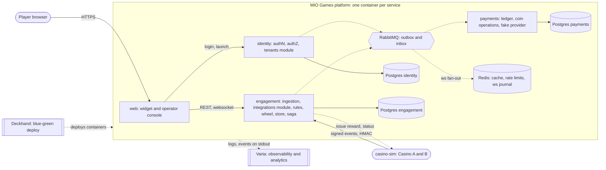
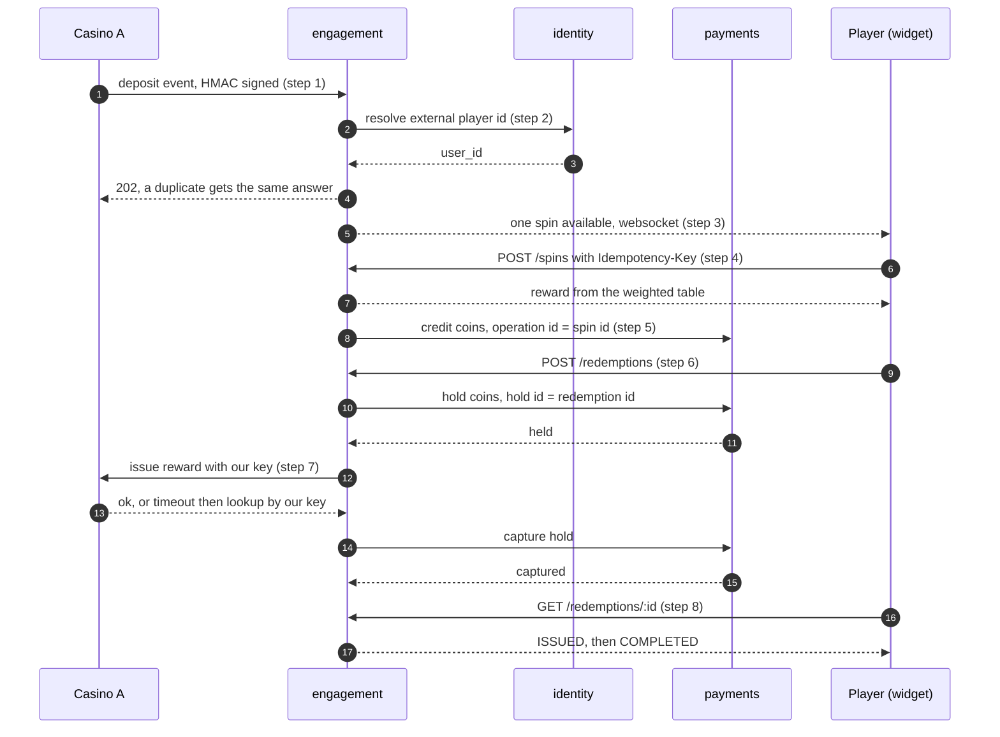
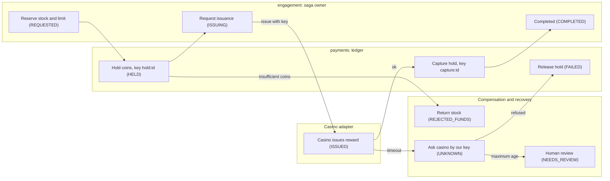
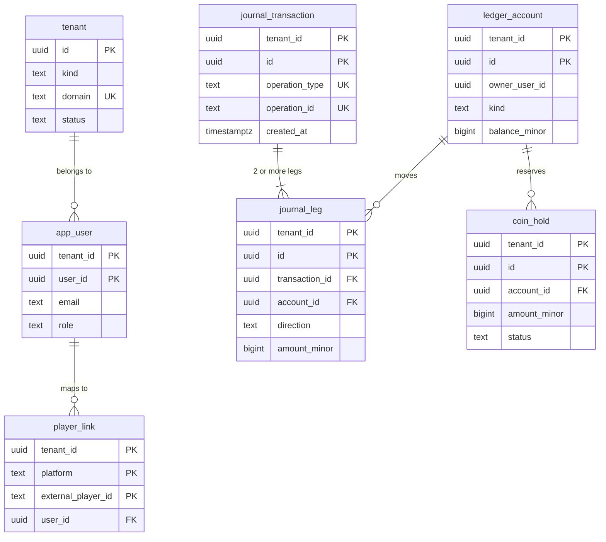
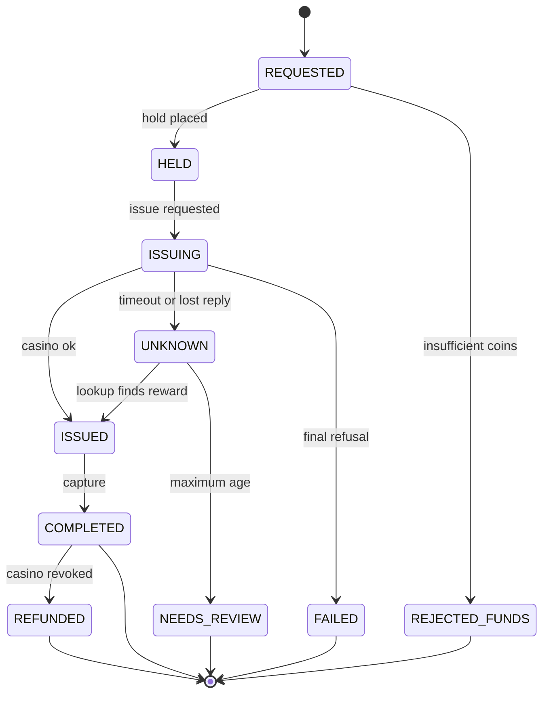

# Architecture diagrams

Five diagrams, each kept as a typed archify IR file (`*.json`), a rendered interactive page (`*.html`), and a Mermaid copy below that renders inline on any git host. The prose is in [overview.md](overview.md); decisions are in [`docs/adrs/`](../adrs/).

| Diagram | Interactive page | Typed source |
|---|---|---|
| Context and containers | [architecture.html](architecture.html) | [architecture.json](architecture.json) |
| Sequence: the 8-step workflow | [sequence.html](sequence.html) | [sequence.json](sequence.json) |
| Workflow: redemption saga with compensations | [workflow.html](workflow.html) | [workflow.json](workflow.json) |
| ERD: tenancy and ledger | [erd.html](erd.html) | [erd.json](erd.json) |
| Lifecycle: redemption states | [lifecycle.html](lifecycle.html) | [lifecycle.json](lifecycle.json) |

The HTML pages are standalone files; open them locally in a browser (a git host shows their source, not the page).

## Tooling and version

- Archify is a git submodule at `tools/archify`, pinned to tag `v3.2.0` (commit `208acba8d412335185b2056fedf54b3405df43fb`), Apache-2.0.
- `tools/archify-render.sh` validates and re-renders all five diagrams. `tools/archify-render.sh --check` validates only, for CI. Needs Node 18 or newer and `git submodule update --init tools/archify`.
- The Mermaid copies are written by hand and must agree with the IR files. When one changes, change the other (ADR 0012).
- Built versus designed items are marked in [overview.md](overview.md#14-built-versus-designed). The Stripe adapter, websocket replay, the production identity provider and per-service deployment secrets are designed only.

## 1. Context and containers

## 2. Sequence: the 8-step workflow

## 3. Workflow: redemption saga with compensations

## 4. ERD: tenancy and ledger

Identity tables live in the identity database and ledger tables in the payments database. There is no foreign key between the two; `payments` stores opaque ids.

## 5. Lifecycle: redemption states

